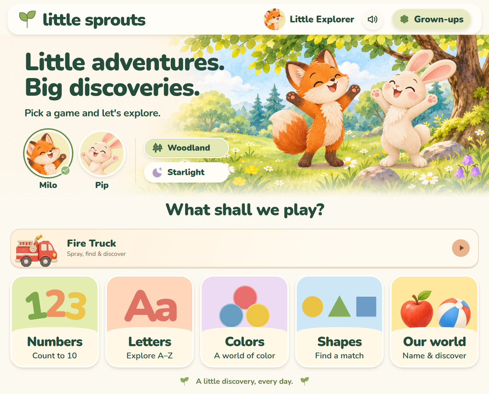
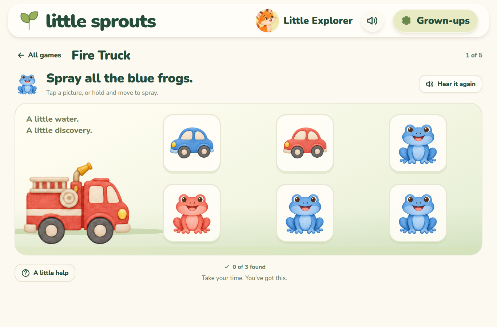
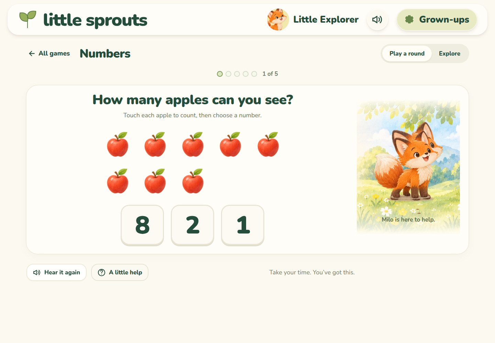

# Little Sprouts

**Little adventures. Big discoveries.**

A gentle browser game for young children and the grown-ups learning alongside them. Count apples, meet every letter, discover colors and shapes, and name familiar things—with a friendly fox or bunny nearby.

[Play Little Sprouts](https://sprouts.campbellservers.com/) · [Run it locally](#run-it-locally) · [Self-host it](#self-host-it) · [Learning approach](docs/CURRICULUM.md)

[](https://github.com/AaronCampbellit/Little-Sprouts/actions/workflows/checks.yml)



## Made for small discoveries

Little Sprouts started as a small family game for a three-year-old, with room to grow. It is built around shared play, spoken instructions, clear choices, and a pace the child controls. There are no countdowns, speed rewards, ads, or failure screens.

| Activity | What children can explore |
| --- | --- |
| **Numbers** | Numerals 1–10, touching objects one at a time, and connecting a collection with its total |
| **Letters** | All A–Z, letter names, familiar example words, and uppercase, lowercase, or paired forms |
| **Colors** | Ten colors: red, blue, yellow, green, orange, purple, pink, brown, black, and white |
| **Shapes** | Circle, square, triangle, rectangle, oval, star, heart, and diamond |
| **Our world** | Twelve familiar objects, including animals, toys, food, and everyday things |
| **Fire Truck** | Spray every matching picture by color and object: blue frogs, yellow cars, and more |

Choose **Milo the fox** or **Pip the bunny**, then visit **Woodland** or **Starlight**. Characters and worlds share the same learning records, so changing the scenery does not reset discoveries.

### Fire Truck

Aim the fire truck's hose and spray every matching picture. **“Spray all the blue frogs”** asks the child to notice both color and object—a blue car or a yellow frog stays unsprayed.

Click or tap a picture, hold and move the mouse or finger to spray across the board, or use the keyboard to activate the picture buttons. Heart speaks the prompt, hints gently highlight matching pictures, and each found picture keeps its water-and-check mark. There are no sirens, flames, moving targets, or time limits. The next discovery stays unavailable until every match is found, and the child chooses when to continue.

Little steps offers four pictures with two matches; Growing discoveries offers six pictures with three matches. Rounds follow the grown-up setting of five or ten discoveries, beginning with blue frogs and yellow cars. Fire Truck records its own local progress alongside the other activities.



### Two ways to play

The five core activities—Numbers, Letters, Colors, Shapes, and Our world—offer these modes:

- **Explore:** choose any item and hear its name. All ten numbers and the complete alphabet are always available.
- **Play a round:** try five or ten questions, repeat instructions, ask for a hint, and continue when ready. Correct answers wait for the child to choose the next discovery.



### A little space for grown-ups

Grown-ups can create up to eight local explorer profiles, choose a starting stage, adjust the counting range and letter forms, preview narration, and download or restore a progress backup.

| Setting | Options |
| --- | --- |
| Starting stage | Little steps, around 2–3; Growing discoveries, around 3–4 |
| Practice choices | Two in Little steps; three in Growing discoveries |
| Counting range | 1–5 or 1–10 |
| Letter forms | Uppercase, lowercase, or together |
| Round length | Five or ten questions |
| Sound | Spoken prompts and gentle sounds on or off |

Age ranges suggest a starting point. Children can explore the full content with adult support; knowing every letter or independently counting ten objects is not a requirement at age three. Progress reports describe practice observations, rather than grades, mastery, or developmental assessment. See the [curriculum notes and sources](docs/CURRICULUM.md).

## Run it locally

You need **Node.js 24 or newer** and **npm**. No database, API keys, Python environment, or speech model is required to run the game. The artwork, fonts, and prerecorded narration are included.

```sh
git clone https://github.com/AaronCampbellit/Little-Sprouts.git
cd Little-Sprouts
npm ci
npm run dev
```

Open **http://127.0.0.1:5173/**. Click a game or use **Grown-ups → Test sound** to enable browser audio.

To check and preview a production build:

```sh
npm test
npm run build
npm run preview -- --port 4173
```

Open **http://127.0.0.1:4173/**. Build output is written to `dist/`.

| Command | Purpose |
| --- | --- |
| `npm run dev` | Start the local Vite development server |
| `npm run typecheck` | Check TypeScript without emitting files |
| `npm test` | Run the learning, save, narration, and motion checks |
| `npm run build` | Type-check and create the production site |
| `npm run preview` | Preview the built site locally |
| `npm run voices:generate` | Regenerate narration using the optional local voice toolchain |

GitHub Actions runs the tests and production build for pushes to `main` and pull requests. Normal builds use the included audio; voice generation is a separate development workflow.

## Self-host it

Little Sprouts builds to a **static website**. Serve the entire `dist/` directory at the root of an HTTPS origin using Caddy, Nginx, or another static host. Include the audio, fonts, and artwork; copying only `index.html` is not enough. A server-side Node process is unnecessary.

For a local Docker deployment with the included Caddy configuration:

```sh
npm run build
docker compose -f deploy/compose.yaml up -d --wait
```

Open **http://localhost:8080/**. The example binds to localhost by default. Configure the bind address and reverse proxy for your own server; use HTTPS when accessing it from another device. Subdirectory hosting, such as `/games/sprouts/`, is not configured in this version.

The [deployment guide](docs/DEPLOYMENT.md) covers settings, static-host requirements, releases, and rollback. It does not contain credentials or the live server's private operational details.

## Gentle motion is a project rule

The interface should respond promptly while the game stays calm. No flashes, strobes, blinking rewards, rapid repeated cuts, abrupt camera moves, forced fast-paced action, or automatic question advancement.

| Interaction | Fade duration |
| --- | --- |
| Menus | 240 ms |
| Pickers and local feedback | 180 ms |
| Simple question changes | 420 ms |
| World and environment changes | 1,200 ms |
| Future action-scene transitions | 2,000 ms |

Content fades through the existing scene. Reduced-motion preferences remove decorative bobbing, rotation, and slides while keeping controls responsive. These timings are design choices, not medical or developmental thresholds. New activities and theme packs must follow [AGENTS.md](AGENTS.md) and the shared policy in [`src/transitions.ts`](src/transitions.ts).

## A consistent voice

**Heart** narrates the game through **293 self-hosted recordings**, generated locally with Kokoro-82M. Clips load as needed and play through Web Audio; no installed system voice is required. Repeat, mute, activity changes, and leaving the page cancel current or pending narration, including delayed requests.

An available English device voice is a fallback if a recording cannot play. **Grown-ups → Test sound** previews Heart. The parent settings identify the recordings as AI-generated.

Changing spoken content requires updating the shared narration catalogue and generating its new recordings. The [voice workflow](docs/VOICES.md) documents the pinned tools, verified model files, pronunciation handling, and checks. Generation tools and model weights are excluded from Git and production builds.

## Saves and privacy

Explorer nicknames, settings, and progress stay in the current browser's `localStorage`, under `little-sprouts:v1`. The app has no child accounts, analytics scripts, advertising, or progress-upload API. Hosting providers can still receive ordinary web requests and maintain access logs.

- **Back up:** Grown-ups → Download backup.
- **Move devices:** download on one device, then restore the JSON file on the other.
- **Restore carefully:** restoring replaces all explorer profiles in that browser.
- **Keep backups private:** exports can contain nicknames and progress; do not add them to this repository.

Clearing browser storage or changing browser, device, or site origin does not transfer saves automatically. There is no cloud sync or offline installation workflow in this version. Grown-up settings manage local play; they are not an authenticated parent account or a parental lock.

## How it is built

The app uses **TypeScript, Vite, native HTML/CSS, and Phaser**. Learning controls and text are native browser elements. Phaser animates the companion on wider screens and loads separately from the main interface; compact layouts use the illustrated companion.

```text
src/
  content.ts          Activities, characters, worlds, and item catalogues
  learning.ts         Questions, rounds, and progress accounting
  firetruck.ts        Color-and-object goals, boards, and matching rules
  firetruck-game.ts   Hose input, mini-game presentation, and round lifecycle
  speech-text.ts      Shared runtime and recording text
  audio.ts            Heart playback, cancellation, caching, and fallback
  recordings.ts       Audio manifest validation and lookup
  storage.ts          Local profiles, save validation, and backup import
  main.ts             Navigation and interaction coordination
  views.ts            Native game screen markup
  parents.ts          Grown-up settings and progress controls
  transitions.ts      Shared gentle-motion policy
  scene.ts            Optional Phaser companion
public/
  assets/             Self-hosted illustrations and Nunito fonts
  audio/              Heart MP3 recordings, manifest, and attribution
  licenses/           Included third-party license texts
tests/                Learning, storage, narration, and motion checks
scripts/              Optional local narration generation tools
deploy/               Caddy and Docker Compose configuration
docs/                 Curriculum, design, narration, and hosting guides
```

Tests check content coverage, question correctness across many random seeds, counting limits, theme-independent skills, hint/first-try accounting, backup validation, narration coverage and checksums, safe audio paths, and motion settings. The optional Python tests check pronunciation regressions when the voice toolchain is installed.

## Growing the game

Keep learning rules separate from characters and artwork. A new character should not need a new counting implementation, and changing a theme should not change a child's skill identifier.

When adding content:

1. Define the objective and record its curriculum sources in `docs/CURRICULUM.md`.
2. Add content and question rules with stable skill identifiers.
3. Update the spoken-text catalogue and include recordings for every new line.
4. Preserve the motion policy, reduced-motion behavior, and child-controlled pace.
5. Run the checks and build, then try the change with mouse, keyboard, and a landscape touch layout.
6. Plan save migration before changing the stored schema.

Possible future activities include sorting, patterns, quantity comparison, position words, rhyming, and picture-supported vocabulary. Word reading, additional languages, downloadable/offline play, and cross-device saves are future work—not current features. Suggestions and reproducible bug reports are welcome through [Issues](https://github.com/AaronCampbellit/Little-Sprouts/issues); use generic profiles rather than sharing a child's progress export.

## Documentation

- [Curriculum and learning progression](docs/CURRICULUM.md)
- [Heart narration and generation](docs/VOICES.md)
- [Design and motion specification](docs/design/DESIGN.md)
- [Artwork prompts and provenance](docs/design/image-prompts.json)
- [Self-hosting and recovery](docs/DEPLOYMENT.md)
- [Third-party notices](THIRD_PARTY_NOTICES.md)
- [Landscape gameplay screenshot](docs/images/landscape.png)

## Rights and attribution

This repository is public, but the original project is **not released under an open-source license**. Existing rights are retained; publishing the source does not add a new license grant.

Bundled third-party components retain their own licenses, including Phaser (MIT) and Nunito (SIL Open Font License). The narration uses Kokoro's Heart voice; its provenance and upstream license notices are included. The storybook artwork was generated using ImageGen, with prompts recorded in this repository. See [THIRD_PARTY_NOTICES.md](THIRD_PARTY_NOTICES.md) for the component details.
